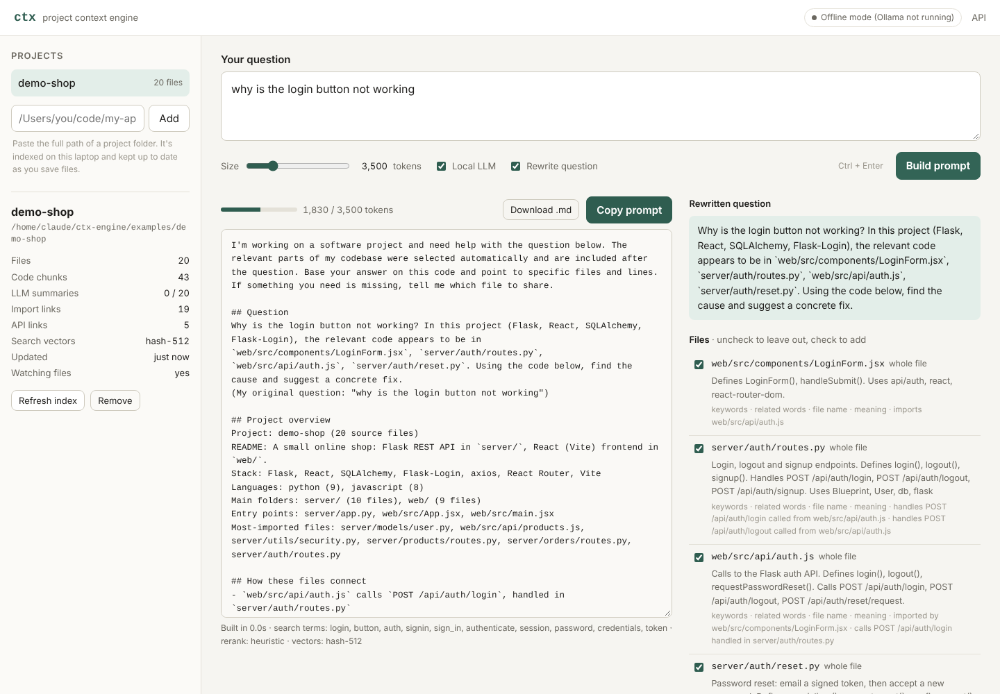

# ctx: local project context engine

**Ask a question about your code; get back a prompt that any chatbot can answer properly.**

Ask ChatGPT "why is the login button not working?" and it can only guess. ctx runs on your laptop, reads your project, and turns that question into a prompt containing:

- a **rewritten, specific question** that names the files and layers involved
- a short **project overview**: stack, folders, entry points
- the **relevant code only**: the right functions from the right 4–6 files, with line ranges
- **how those files connect**, e.g. `LoginForm.jsx` → `auth.js` → `POST /api/auth/login` → `routes.py`
- with **secrets removed** (API keys, passwords, tokens) before anything leaves your machine

You paste it into ChatGPT, Gemini, Claude or any chatbot, in the browser or a terminal. On a 216-file repo (Flask) the prompt is about 3,500 tokens, where pasting the whole codebase would take 244,000.



---

## Cloud development

See [SETUP.md](SETUP.md) for the tested Python environment, test commands, and offline server startup. No Ollama models are required for offline mode.

## Quick start (macOS)

```bash
# 1. Local models (one time). Without them ctx still works in offline mode.
brew install ollama
ollama serve &                 # or open the Ollama app
ollama pull qwen3:4b           # 2.5 GB: query expansion, rerank, rewrite, file summaries
ollama pull embeddinggemma     # 622 MB: semantic search

# 2. Install ctx
brew install pipx && pipx ensurepath
pipx install /path/to/ctx-engine          # or: pip install -e /path/to/ctx-engine

# 3. Run the web app
ctx serve                      # opens http://127.0.0.1:7777
```

In the web app, paste a project folder path (e.g. `/Users/you/code/my-app`), wait for indexing, type a question and press **Copy prompt**.

Try it on the included demo first. It's a Flask + React shop with a real bug in it:

```bash
ctx serve --add examples/demo-shop
# ask: "why is the login button not working"
```

### Linux

Same steps; install Ollama with `curl -fsSL https://ollama.com/install.sh | sh`. For clipboard copy from the CLI, install `xclip` (X11) or `wl-clipboard` (Wayland). For very large repos you may need to raise the inotify limit: `sudo sysctl fs.inotify.max_user_watches=524288`.

### Docker (Linux only, optional)

```bash
PROJECTS_DIR=~/code docker compose up -d     # starts Ollama, pulls the models, starts ctx
# open http://localhost:7777 and add projects as /projects/<folder>
```

On a Mac, install natively instead: Docker can't use the Apple GPU, so models would run several times slower.

---

## Command line

```bash
ctx index [PATH]                 # build/refresh the index (add --fast to skip LLM summaries)
ctx prompt "question" -p PATH    # build a prompt and copy it to the clipboard
    --budget 5000                #   max prompt size in tokens (default 3500)
    --include src/x.py           #   force a file in   (repeatable)
    --exclude src/y.py           #   leave a file out  (repeatable)
    --out prompt.md --show       #   save / print it
    --no-llm                     #   skip the local LLM (faster, less precise)
ctx serve                        # web app on http://127.0.0.1:7777
ctx watch [PATH]                 # keep an index fresh while you code
ctx status [PATH]                # what's in the index
ctx overview [PATH]              # the project overview used in prompts
ctx doctor                       # check Ollama, models, clipboard
ctx config --set llm_model=qwen3:1.7b
```

Pipe into a terminal chatbot: `ctx prompt "why does checkout fail" --no-copy --show | claude -p`

---

## How it works

```
INDEX (once per project, then only changed files)
  scan folder ─► parse files ─► link imports + API calls ─► summarize (qwen3:4b) ─► embed (embeddinggemma) ─► SQLite
       ▲                                                                                                  .ctx/index.db
       └── file watcher: re-indexes a file seconds after you save it

PROMPT (every question)
  expand query ─► hybrid search ─► follow graph ─► rerank + rewrite ─► pick snippets ─► pack to budget ─► redact secrets
  (LLM terms)     (BM25+vectors     (imports,      (qwen3:4b, one      (functions,       (overview,        (keys, passwords,
                   +file names)      API links)     JSON call)          not whole files)  question, code)   tokens, URLs)
```

| Stage | What it does | NLP technique |
|---|---|---|
| Parse | Functions, classes, methods, imports, HTTP routes for Python (AST), JS/TS, Java, Kotlin, Go, Rust, C/C++, C#, PHP, Ruby, Swift, Dart | structural code analysis |
| Graph | Resolves imports to files; links frontend `fetch('/api/x')` / `axios.post` to the backend route that handles it (Flask, FastAPI, Express, Spring, Gin…) | dependency graph |
| Summaries | 2-sentence description of each file, cached by content hash | abstractive summarization |
| Expansion | "login button" → `onSubmit`, `handleSubmit`, `auth`, `/api/auth/login` | query expansion |
| Search | SQLite FTS5 BM25 + cosine similarity on embeddings + file-name match, merged by normalized score fusion | hybrid lexical + semantic retrieval |
| Graph step | Adds files directly connected to the top hits; damped for hub files everything imports | graph-based retrieval |
| Rerank + rewrite | One local LLM call picks the 2–6 files that matter and rewrites the question to name them | LLM reranking, query rewriting |
| Packing | Chooses whole small files or the best-scoring functions of big ones, within the token budget | context compression |
| Redaction | Regex + entropy rules for 15+ secret formats; `.env`, keys and credential files are never read | sensitive data filtering |

Everything degrades gracefully: with Ollama off, ctx uses a synonym dictionary for expansion, hashed term vectors for search, score-based selection and a template rewrite. It still finds the right files on the evaluation sets below.

More detail: [docs/architecture.md](docs/architecture.md).

---

## Evaluation

```bash
python eval/run_eval.py eval/questions/demo-shop.json
git clone --depth 1 https://github.com/pallets/flask ~/code/flask
python eval/run_eval.py eval/questions/flask.json --repo ~/code/flask
python eval/run_eval.py eval/questions/demo-shop.json --answer-sheet eval/answer-sheet   # for the chatbot A/B test
```

Baseline results **in offline mode** (no Ollama, measured while building this project) are in [`eval/results/`](eval/results):

| Repo | Files | Whole repo | Median prompt | Recall (files found) | Hit@1 |
|---|---|---|---|---|---|
| demo-shop | 20 | 2,448 tokens | 1,717 tokens | 92% | 75% |
| Flask | 216 | 244,194 tokens | 3,466 tokens (98.6% smaller) | 93% | 71% |

Re-run on your Mac with Ollama running to get the full-pipeline numbers (LLM rerank + embeddinggemma) for the report.

**Answer-quality A/B test.** `--answer-sheet` writes, for each question, the plain question and the ctx prompt. Paste each into a fresh ChatGPT chat, score both answers 0–2 in `scores.csv` (0 = wrong/generic, 1 = partly right, 2 = finds the real cause), and report the averages.

---

## Configuration

`~/.ctx/config.json` (or `CTX_<NAME>` env vars), shown with defaults:

| Setting | Default | |
|---|---|---|
| `llm_model` | `qwen3:4b` | `qwen3:1.7b` for older laptops |
| `embed_model` | `embeddinggemma` | `qwen3-embedding:0.6b` for longer chunks |
| `use_llm` | `true` | `false` = fully offline heuristics |
| `budget` | `3500` | default prompt size in tokens |
| `max_files` | `6` | files per prompt |
| `summarize` | `true` | LLM file summaries while indexing |
| `extra_ignore` | `[]` | gitignore-style patterns; a `.ctxignore` file in the project works too |

Memory: about 3.5 GB while building a prompt with both models loaded; Ollama unloads them after a few idle minutes.

## Privacy

- The server listens on `127.0.0.1` only and rejects requests addressed to any other host name (DNS-rebinding protection).
- The index lives in `<project>/.ctx/` (git-ignored automatically). Nothing is uploaded anywhere.
- `.env*`, private keys, keystores and credential files are never read. Everything else is passed through the redactor before it's shown to you.

## Project layout

```
ctx/
  index/    scanner · parser · chunker · graph · summarizer · embedder · store · overview · indexer · watcher
  query/    expand · retriever · rerank
  prompt/   snippets · redactor · builder
  llm.py    Ollama client          manager.py  projects, jobs, history
  server.py local API + web app    cli.py      `ctx` command
  web/      index.html · app.js · style.css
tests/      23 tests, including a fake Ollama server for the LLM paths
eval/       questions, evaluation script, results
examples/demo-shop/   Flask + React demo with a deliberate bug
```

Run the tests: `pip install -e ".[dev]" && pytest`

## Limitations and next steps

- Non-Python languages are parsed with targeted regexes plus brace matching, not full grammars. That's accurate for normal code but can miss unusual syntax; tree-sitter would be a drop-in upgrade for `parser.py`.
- Planned: a browser extension that adds an "Add project context" button inside ChatGPT, a `pywebview` desktop window, and an MCP endpoint for terminal assistants.
